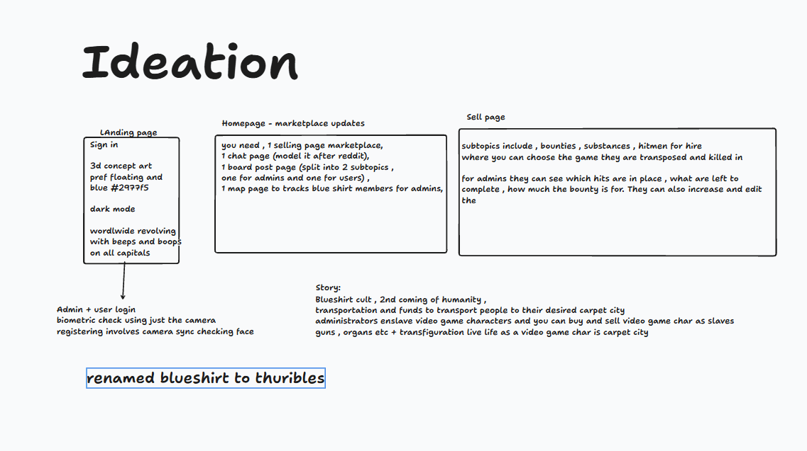

# THURIBLES

Public link: https://thuribles.vercel.app
if you want a throwaway account to test stuff on : user: fff , pass:123
admin coupon is toor , but i would suggest you try out the face login etc.
## Story

After the concierge of crime and his partners realized that hiding in source code could be a way to escape the watchful eyes of the government and act as a bunker for their secrets and wealth transferred seamlessly from reality to the extradigital world, they jumped on the opportunity and build thuribles which facilitates multiple services and more.

This entire story + the thought was brought to you by my excessive consumption of crime and detective films and tv shows including but not limited to The Blacklist , John Wick , 007 etc etc. Hope you enjoy my idea of a dark marketplace.

## Why Thuribles
MJWHKZLTNBUXE5A fro mthe case-debrief.pdf which is the machine ID gives us blueshirt when you decode it in base32 and an anagram of blueshirt is thuribles - which is basically an incense holder

## Initial Ideation



## Features

**Landing and sign-in**
- Landing page with a revolving 3D globe that pings every capital city with a beep. Audio starts after the first click.
- Face sign-in through the camera, using an in-browser face match.
- Username and password sign-in as an alternative.
- Face ID is optional at sign-up. Without one you can browse but not hire, accept contracts or buy in Sosumi. You can add it later.
- Admin sign-up with an invite code. Existing members can raise themselves to admin with the code.
- Starting balance of 500 bits for new members.
- The globe also runs faintly behind every app page.

**Home**
- Hero with a swinging thurible that reveals the name, and the line "Welcome the new reign".
- Three columns showing the latest substances, contracts and enslavement records, five each, with "See all" links.
- A live map of open contracts and the 55 bunker sites, with the closest six contracts listed. Contracts you've accepted show green, and completed ones are hidden.
- Stats row.

**Marketplace**
- Four tabs: contracts, substances, hitmen for hire and enslavement records. Completed contracts sort to the end.
- Posting listings with an image upload or preset. Contracts also need a location chosen on a map, with a "use my location" button.
- Substances have a cart and checkout, with a dead drop or a hand-delivered option (extra fee).
- Checkout ends in an animation of an eye darting left and right and zooming in until the screen goes black. Then a red tick shows "Order confirmed", a date three days away, and a chime.
- Hiring a hitman takes a target name, last-seen place, occupation, details and photos.
- Accepting a contract or task, then submitting photo proof. Admins grade the proof from 0 to 100 and the payout is that share of the reward.
- "My activity" shows your jobs, hires and orders. Admins also see all hit requests and the proofs waiting for grading.
- Admins get a hit-control table.

**Money**
- A transaction ledger records every movement of bits.
- Hiring a hitman and posting a contract or task reserve the amount from your balance. The funds are released on completion, or refunded if the hit is declined or the listing is removed.
- Wallet page with available and reserved bits, transfers to other members by handle, and a transaction history.
- Exchange page converting Bitcoin or Binance into bits at live rates.
- The balance shows in the navbar and account menu.
- Buying properties in Sosumi costs bits.

**Admin economy dashboard**
- Money in circulation, deposits, volume in the last 24 hours, member transfers, a 14-day volume chart, a breakdown by type and the biggest holders.
- Live transaction feed.
- Figures of 13 digits or more switch to scientific notation.

**Chat**
- One global group chat with replies and reactions (heart, thumbs up, smile, laugh, cry).
- Admins can pin messages.
- Live updates.

**Board**
- Admin-only posting, with optional video upload. The latest post is shown big and bold.
- Everyone else reacts with the same emojis.
- Custom video player with play/pause, volume, mute and a red seek bar.

**Sosumi**
- A 3D city you can rotate and zoom, with 120 properties: 40 plots, 40 houses and 40 apartments.
- Click a property to see its price and owner, and buy it (with Face ID).
- Ownership updates live.

**Content**
- Seven teammate contracts with harmless tasks, 20 game-character enslavement tasks, 3 hitmen and 9 substances.

## Running it locally

You need Node.js 20 or newer and a modern browser. Chrome is recommended because the face scan uses the camera.

1. Clone the repository and open the folder.

   ```
   git clone https://github.com/ogshrug/exunhack26-dpsn.git
   cd exunhack26-dpsn
   ```

2. Install the dependencies.

   ```
   npm install
   ```

3. Copy the example environment file and fill it in.

   ```
   cp .env.example .env.local
   ```

   Set `VITE_SUPABASE_URL` and `VITE_SUPABASE_ANON_KEY` to the project URL and public key that were submitted with the entry.

4. Start the dev server.

   ```
   npm run dev
   ```

5. Open http://localhost:5173. The camera works on localhost without HTTPS.

6. Create an account on the register page. Use a username and password if you do not want to use the camera.

To make a production build, run `npm run build`. The output goes to `dist/` and `npm run preview` serves it.

## Backend

Services used: Postgres with row level security, Auth, Realtime, Storage and Edge Functions.

### Tables

| Table | Columns |
| --- | --- |
| profiles | id, handle, role, face_embedding, balance, created_at |
| credentials | id, pw_hash |
| listings | id, seller_id, category, title, description, price, game, target_character, status, claimed_by, image_url, lat, lng, resale_price, escrow, created_at |
| hires | id, listing_id, client_id, hitman_id, hitman_title, target_name, last_seen, occupation, details, images, price, status, created_at |
| proofs | id, listing_id, user_id, images, note, status, grade, payout, created_at, reviewed_at |
| orders | id, buyer_id, listing_id, title, method, address, price, fee, qty, created_at |
| transactions | id, kind, from_id, to_id, amount, memo, created_at |
| topups | id, user_id, inr, rate, bits, asset, amount, created_at |
| rates | id, usd_inr, btc_usd, bnb_usd, updated_at |
| plots | id, owner_id, price, purchased_at |
| members | id, handle, city, lat, lng, last_seen |
| chat_messages | id, author_id, body, reply_to, pinned, created_at |
| chat_reactions | message_id, user_id, emoji |
| board_posts | id, author_id, audience, title, body, video_url, created_at |
| board_reactions | post_id, user_id, emoji |
| channels, posts, votes, news | older discussion and news tables |

Listing categories are `contract`, `substance`, `hitman` and `enslavement`. Listing status is `open`, `claimed` or `completed`.

### Server side

- Edge Functions: `face-register`, `face-login`, `face-enroll`, `password-register`, `password-login`, `promote`, `exchange-rate`
- Database functions called from the app: `my_balance`, `my_escrow`, `has_face`, `buy_cart`, `hire_hitman`, `resolve_hire`, `accept_contract`, `submit_proof`, `grade_proof`, `topup_bits`, `transfer_bits`, `set_pinned`, `economy_stats`
- Storage buckets: `listing-images` and `board-videos`
- All balance changes happen inside database functions, never from the browser. Members can only read their own wallet and transaction rows, and admins can read everything.

## Stack

React 19, TypeScript, Vite, Tailwind CSS, React Router, three.js with react-three-fiber, MapLibre GL, face-api and Supabase.
